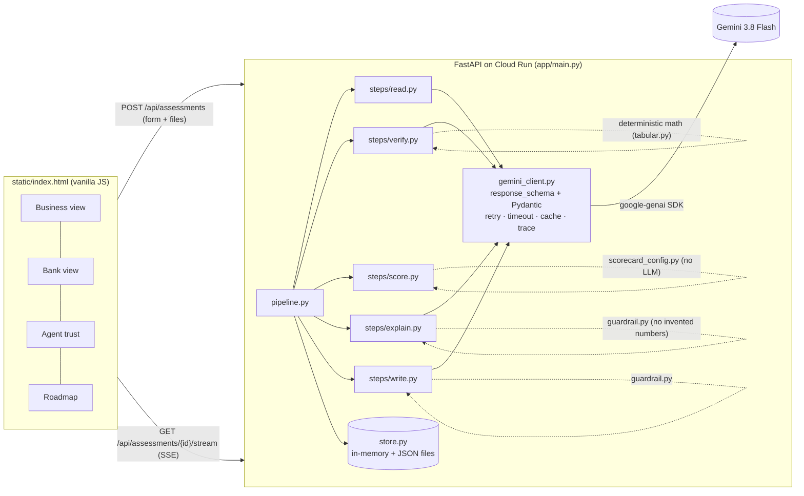

# Kervan Credit Passport

**An AI underwriting agent that turns a small business's informal records — ledger photos, bank statements, payment exports — into a verified, explainable credit passport a bank can trust and act on.**

Built for the Google Cloud AI Builder Cup 2026 (BFSI: Intelligent Risk, Fraud & Financial Experiences). Market: Mongolia (₮ MNT).

> **Core principle, visible in code and UI:** Gemini *reads, verifies, explains and writes*. The credit decision comes from a deterministic, auditable scorecard in [`app/scorecard_config.py`](app/scorecard_config.py). The LLM never sets or changes the score.

---

## What it does

| Step | Who | What |
|---|---|---|
| 1 READ | Gemini (multimodal, structured output) | One call per document: ledger photo (JPG/PNG), bank statement (PDF/CSV), payment export (CSV) → monthly figures and extracted fields, each with a `source_document` + `page_or_row` pointer and a confidence. For CSVs the prompt also receives Python's deterministic monthly column sums, so the model transcribes and cites instead of adding rows. |
| 2 VERIFY | Python **and** Gemini | Python re-sums CSVs, checks month continuity, averages, coefficient of variation, outliers, declared-vs-bank, ledger-vs-bank, payments-vs-bank, stated totals, account age, account-holder name. Gemini adds qualitative checks and flags. Merge rule: values always from Python; the more conservative status wins; model flags carry no penalty. |
| 3 SCORE | Python only | Points-based scorecard over verified inputs. Unverified inputs count at 50 %, inconsistent at 0 %. Points → grade K1…K7 → PD estimate → rate band → suggested limit/tenor. Per-factor reason codes. Unit-tested. |
| 4 EXPLAIN | Gemini + guardrail | Plain-language owner summary (English + Mongolian) and a ranked improvement plan. **Expected gains are computed by re-running the scorer**, never guessed. A number guardrail rejects any figure not present in the inputs (retry once, then deterministic fallback). |
| 5 WRITE | Gemini + guardrail | Underwriter-ready credit memo (JSON → Markdown → HTML) with an evidence appendix. Same number guardrail. |

The UI streams each step over Server-Sent Events so the "Agent pipeline" panel shows real progress, latency and log lines.

## Architecture



Data flow for one assessment:

```
uploaded files ─▶ READ (Gemini ×N, parallel) ─▶ DocumentRead[]
declared form ──┐
DocumentRead[] ─┴▶ VERIFY (Python checks + Gemini checks, merged) ─▶ VerifyResult {checks, flags, verified_inputs}
VerifyResult ─▶ inputs_from_verification() ─▶ SCORE (deterministic) ─▶ ScoreResult + Simulations
ScoreResult + Simulations ─▶ EXPLAIN (Gemini words; impacts from simulator) ─▶ ExplainResult
everything ─▶ WRITE (Gemini memo; Python renders Markdown/HTML) ─▶ WriteResult
```

## Project layout

```
app/
  main.py             FastAPI app, routes, SSE orchestration, static files
  pipeline.py         READ → VERIFY → SCORE → EXPLAIN → WRITE with progress events
  config.py           env vars + default model
  gemini_client.py    single google-genai wrapper: schema, retry-once, timeout, cache, trace
  schemas.py          Pydantic models (Gemini-facing + internal)
  scorecard_config.py all weights, bands, grades, PD estimates, rate bands (Kervan's own policy)
  guardrail.py        number guardrail for EXPLAIN/WRITE
  tabular.py          deterministic CSV monthly sums
  store.py            in-memory dict + JSON files
  offline.py          developer-only fixture mode (KERVAN_OFFLINE=1)
  steps/read.py verify.py score.py explain.py write.py
prompts/              read.txt verify.txt explain.txt write.txt (versioned, guardrails inside)
static/               index.html styles.css app.js
fixtures/generate.py  synthetic test businesses (Pillow ledger photo, bank CSV/PDF, payment CSV) for tests and offline mode
fixtures/personas/    generated fixture files
tests/                test_score.py (scorer) test_verify_math.py (verification math + CSV sums) test_store_uploads.py (uploads, reset, offers)
Dockerfile · deploy.sh · deploy.ps1 · dev.py · requirements.txt
```

## Run locally

Requirements: Python 3.12+ (3.13 works), a Gemini API key.

```bash
python -m venv .venv && . .venv/bin/activate      # Windows: .venv\Scripts\activate
pip install -r requirements.txt
python -m pytest -q                                # 67 tests: scorer, verification math, CSV parsing, storage

cp .env.example .env                               # put GEMINI_API_KEY in .env (never committed)
python dev.py                                      # http://localhost:8080
```

Then open the Business view, fill in the loan request, drop the business's documents (ledger photo, bank statement CSV or PDF, payment-provider export) and run the assessment. A cold run takes 30 to 60 seconds; repeated runs on the same files are served from the cache.

`python dev.py --offline` runs the pipeline against the synthetic fixtures without Gemini (deterministic CSV sums plus templated text) for development and CI only; the Agent-trust view labels every trace from that mode `offline-fixture`.

Environment variables:

| Variable | Purpose | Default |
|---|---|---|
| `GEMINI_API_KEY` | Gemini Developer API key (or `GOOGLE_API_KEY`) | — |
| `GOOGLE_GENAI_USE_VERTEXAI` + `GOOGLE_CLOUD_PROJECT` + `GOOGLE_CLOUD_LOCATION` | use Vertex AI instead | off |
| `GEMINI_MODEL` | model ID | `gemini-3.8-flash` (current stable Flash in the Gemini model catalog) |
| `GEMINI_TIMEOUT_S` | per-call timeout | 90 |
| `GEMINI_THINKING_LEVEL` | `low` keeps a cold run under ~1 min; `high` for deeper reasoning; `none` for the model default | `low` |
| `KERVAN_DATA_DIR` | where assessments, uploads and the Gemini cache are written | `./data` (`/tmp/kervan-data` in the container) |
| `KERVAN_MAX_UPLOAD_MB` | per-file upload limit | 15 |
| `KERVAN_ADMIN_TOKEN` | secret the `X-Admin-Token` header must carry to call `DELETE /api/assessments` (reset); unset = reset endpoint disabled | — |

## Deploy to Cloud Run

Prerequisites: `gcloud` CLI, a GCP project with billing, a Gemini API key.

```bash
export GEMINI_API_KEY=...                 # first time only: creates the Secret Manager secret
./deploy.sh YOUR_PROJECT_ID asia-northeast1
```

Windows: `$env:GEMINI_API_KEY="..."; .\deploy.ps1 -ProjectId YOUR_PROJECT_ID -Region asia-northeast1`

What the script runs (the exact commands):

```bash
gcloud config set project YOUR_PROJECT_ID
gcloud services enable run.googleapis.com cloudbuild.googleapis.com artifactregistry.googleapis.com secretmanager.googleapis.com
printf '%s' "$GEMINI_API_KEY" | gcloud secrets create gemini-api-key --data-file=- --replication-policy=automatic
PROJECT_NUMBER=$(gcloud projects describe YOUR_PROJECT_ID --format='value(projectNumber)')
gcloud secrets add-iam-policy-binding gemini-api-key \
  --member="serviceAccount:${PROJECT_NUMBER}-compute@developer.gserviceaccount.com" \
  --role="roles/secretmanager.secretAccessor"
gcloud run deploy kervan-credit-passport --source . --region asia-northeast1 --allow-unauthenticated \
  --memory 1Gi --cpu 1 --timeout 300 --concurrency 20 --min-instances 0 --max-instances 3 \
  --set-secrets GEMINI_API_KEY=gemini-api-key:latest \
  --set-env-vars GEMINI_MODEL=gemini-3.8-flash,KERVAN_DATA_DIR=/tmp/kervan-data,GEMINI_TIMEOUT_S=120,GEMINI_THINKING_LEVEL=low
gcloud run services describe kervan-credit-passport --region asia-northeast1 --format='value(status.url)'
```

Verify:

```bash
URL=https://kervan-credit-passport-xxxx.a.run.app
curl -s $URL/healthz
curl -s $URL/api/config
```

Notes: the container filesystem is read-only except `/tmp`, so assessments and the Gemini cache live in `/tmp/kervan-data` and reset on cold start; the service scales to zero when idle (`--min-instances 0`), so the first request after a pause takes a few seconds longer; use `--min-instances 1` to keep it warm. To reset assessments and uploaded documents, set `KERVAN_ADMIN_TOKEN` on the service and call `curl -X DELETE -H "X-Admin-Token: $KERVAN_ADMIN_TOKEN" "$URL/api/assessments?confirm=yes"` (the endpoint answers 403 while the variable is unset); locally, `python -c "from app.store import store; store.clear()"` does the same. No secrets are in the repo: the key is read from Secret Manager at runtime.

**Access:** the service is deployed with `--allow-unauthenticated` and has no login, so anyone with the URL can see every assessment, memo and uploaded document. Put it behind Identity-Aware Proxy, a Cloud Run IAM policy, or an application login before uploading documents that belong to real customers.

## Walkthrough (3 minutes)

1. **Business view.** Fill in the loan request (declared monthly revenue, years in business, amount, tenor, purpose) and drop the records: a ledger photo, a bank statement as CSV or PDF, a payment-provider export.
2. **Run assessment.** The pipeline panel shows the real steps completing: *Read* (Gemini extracts monthly figures from each document with page/row pointers), *Verify* (Python re-sums the CSVs and compares the declaration with the bank; Gemini adds qualitative checks), *Score* (deterministic), *Explain*, *Write*.
3. **Passport.** Grade, PD estimate, rate band, suggested limit. Factor bars: solid = verified, striped = partially verified, dashed = self-declared at half weight, hatched = inconsistent at zero. Flags and penalties. Toggle the summary to Монгол. Improvement plan with gains computed by re-running the scorer.
4. **Bank view.** The passport arrives anonymized (KCP-xxxx). Open the Gemini-drafted credit memo: business summary, cash-flow analysis, verification status, risks and mitigants, the deterministic scorecard table, evidence appendix. Make an offer; when the business accepts it in the Business view, the identity is revealed to the bank.
5. **Agent trust view.** Guardrails, step trace (prompt version, model, latency, schema validation, cache hits), the inputs handed to the scorer with their statuses, and the evidence trail from every figure to its document, page or row, and confidence.

## Scorecard (Kervan v0.1)

| Factor | Max | Bands |
|---|---|---|
| Months of documented cash flow | 20 | 12+ → 20 · 9 → 16 · 6 → 11 · 3 → 4 |
| Inflow coverage of reference installment (avg inflow ÷ installment at 20 % reference rate) | 25 | ≥6× → 25 · ≥4× → 20 · ≥3× → 14 · ≥2× → 7 |
| Inflow stability (coefficient of variation) | 15 | ≤0.15 → 15 · ≤0.30 → 11 · ≤0.50 → 6 · else 2 |
| Years in business | 15 | ≥5 → 15 · ≥3 → 11 · ≥1 → 6 · else 2 |
| Share of declared figures verified | 15 | proportional |
| Independent sources that agree | 10 | 3 → 10 · 2 → 7 · 1 → 3 |

Status weights: verified ×1.0, partially verified ×0.75, unverified/self-declared ×0.5, inconsistent ×0. Penalties: warning −3, critical −8, capped at −20. Grades: K1 ≥85 (PD 1.5 %, 14–16 %), K2 ≥75, K3 ≥65, K4 ≥55, K5 ≥45, K6 ≥35, K7 <35 (no standard offer). The weights and bands are Kervan's own initial policy, not derived from any bank's scorecard, and should be recalibrated on observed portfolio performance before being relied on. Everything lives in one file with reason codes, and `tests/test_score.py` pins the behaviour.

## Reliability and trust

* Every Gemini call uses `response_mime_type="application/json"` + `response_schema` (Pydantic model) and is validated; on failure it retries once with the validation error, then returns a clear error state to the UI. The pipeline view never crashes: READ failures per document are collected, EXPLAIN/WRITE failures fall back to deterministic text.
* Per-call timeout (`GEMINI_TIMEOUT_S`), friendly error messages, SSE keepalives.
* Results are cached per (model, thinking level, prompt version, prompt text, file hash) so repeated runs are fast and cheap; the trace shows cache hits.
* Each step logs latency, attempts, schema-validation result and model for the Agent-trust view.
* Prompts live in `prompts/` as versioned text files with the guardrails written into them.
* No protected attributes reach the scorer; the owner's name is stripped before Gemini reasons about verification or explanation.

## Test fixtures

The hackathon rules require synthetic data only, so `fixtures/generate.py` produces three invented businesses (a cashmere workshop, an auto-parts trader, a bakery) with a Pillow-rendered handwritten ledger, bank statements and payment exports. They are used by the offline developer mode and are handy for trying the product without real documents; they are not loaded by the product UI.

## Decisions made without asking

* **Model:** `gemini-3.8-flash`, the current stable Flash model in the Gemini model catalog; overridable via `GEMINI_MODEL`.
* **Region:** `asia-northeast1` default (closest to Mongolia); any Cloud Run region works.
* **Model flags do not penalise.** Gemini's verification flags are displayed but only deterministic flags move the score; Gemini may tighten a status (never loosen it).
* **Account age as tenure proxy.** "Years in business" can reach at most *partially verified* without a registration document.
